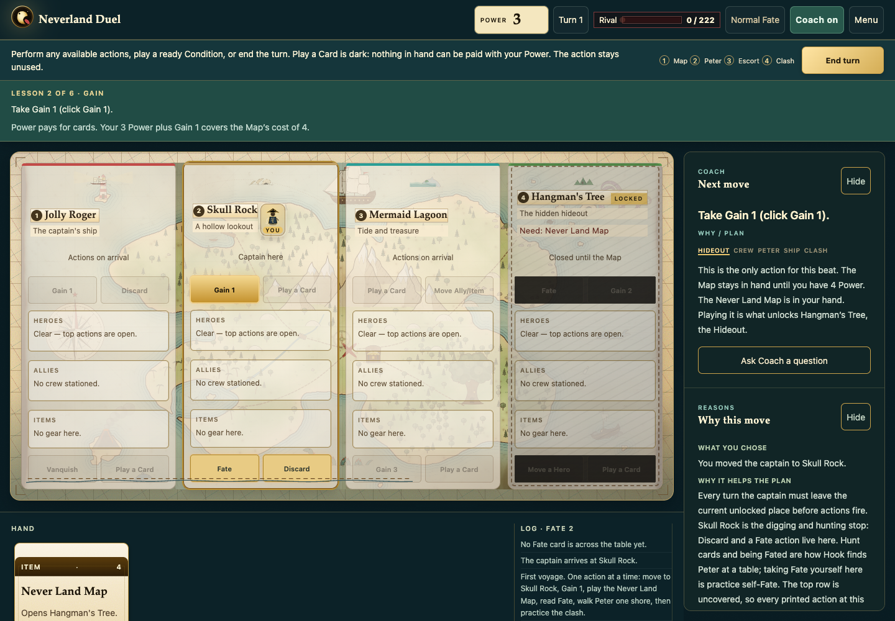

# Neverland Duel

### Practice privately. Join the table with confidence.

A new board game should feel like an invitation. Too often, your first turn feels like a test: everyone else knows the rules, and you are still working out what to click, what it costs, and why it matters.

**Neverland Duel is an independent board-game teaching prototype.** It gives newcomers a place to follow a move, understand the reason, try a decision, and repeat a tricky moment before game night. Its current lesson is Captain Hook’s objective in *Disney Villainous*.

**See a legal move → understand why → try it → reflect → repeat with less help.**

[Play the live game](https://hook-practice-ten.vercel.app/) · [Watch the 48-second introduction](https://hook-practice-ten.vercel.app/submission/explainer.html) · [Submission notes](submission/SUBMISSION.md)



## Start in two minutes

Use **Node.js 22 LTS** and npm. A current desktop Chrome, Edge, Firefox, or Safari can run the game; a wider window is useful for comparing all four shores. The phone layout lets you switch between shores.

```bash
npm ci
npm run dev
```

Open the local URL printed by Vite, normally `http://localhost:5173`, and choose **Tutorial**. No account, API key, or backend service is needed. With nvm, `nvm use` selects the version in `.nvmrc`.

## What makes it a teaching tool

| Experience | What the learner does |
| --- | --- |
| **Six guided lessons** | Move, gain Power, pay for the Map, read Fate, escort Peter, and practise an equal-Strength clash. All hints are on; no plan questions interrupt the first lesson. |
| **Three practice topics, two setups each** | Practise combat, escorting, and preparing the win. Each topic moves from a core skill to a changed situation: Wendy’s Strength boost, chained movement, or Pixie Dust. |
| **Follow along** | Receive a legal next click, an explanation, and every hint immediately. |
| **Choose a plan** | Read the board, choose a plan, and get feedback tied to its actual numbers and route. Optional hints and **Show me every step** remain available. |
| **A shuffled voyage** | Put the steps together against computer Fate pressure. Choose Easy or Normal, with optional coaching. |
| **Reflection and table habits** | Review the completed action, repeat a setup, and learn which solo adaptations differ from a human game. |

Three complementary teaching views support the voyage:

- **Coach:** a concrete, legal next click and why it helps.
- **Why this move:** an explanation of the choice you just made.
- **Strategy brief:** the objective, your progress, and what you are building toward.

Coach and Fate use **local, rule-based heuristics**, not an LLM. The rules engine validates every action, including coached moves. Guidance can be hidden as the learner becomes more comfortable; other legal choices remain available.

**Optional: Ask Coach.** During a lesson or voyage, ask a question about the current position. GPT-6 Luna selects up to three relevant facts prepared by the engine; the interface displays those facts, never model-written rules. Current Strength includes its visible modifiers. Unknown fact IDs, malformed replies, stale positions, and unavailable service responses are rejected. Questions outside the supplied facts receive a clear decline. Ordinary Coach and every game mode work without AI.

Nothing is sent automatically as the game progresses. Asking sends the question and visible board facts to OpenAI, with response storage disabled in the API request. Hidden decks, RNG state, and game logs stay local. The server caps each response at 256 output tokens, caches repeated questions, and limits the demo to 200 uncached requests. This constrains usage; it does not guarantee that every selected fact will fully answer every question.

For local AI help, copy `.env.example` to the ignored `.env.local`, set `OPENAI_API_KEY`, and restart Vite. Keep the file private. **Never use a `VITE_` prefix for a secret.** Local quota usage is stored in ignored `.runtime/luna-budget.json`. [Safe Vercel deployment](docs/vercel.md) explains the server-only key and shared public-demo quota.

## A short reviewer walkthrough

1. **Choose Tutorial.** Start with 3 Power, move to Skull Rock, take Gain 1, and pay 4 for the Never Land Map. The explanation connects the action to unlocking the tree.
2. **Finish the six lessons.** Read and acknowledge Fate, move Peter one neighboring shore, then practise the staged ship clash: 4 + 4 meets 8. The completion screen explains which parts were staged and offers **Play a full voyage with hints**.
3. **Try Make the numbers work.** In **Follow along**, complete the core setup and choose **Try the strategy twist**. Wendy raises Tinker Bell’s Strength; the Brute can meet it while saving the other Ally. **Choose a plan** offers the same topic with feedback before play.
4. **Open Before you play with people.** The six table habits make the transfer to the published game explicit.

The video is a concise introduction to this same learning loop. It uses original, simplified teaching diagrams; it is not a recording of the interface.

## The objective and controls

**Play the Map → reveal Peter → escort him to the Jolly Roger → Vanquish him there.**

Each turn begins with a move to a different unlocked location. Use uncovered actions there, once each, in any order. Heroes cover the top action row. End the turn to refill your hand toward four and face the computer’s Fate play; **Continue** acknowledges the reveal.

Gold outlines identify legal targets; a stronger gold highlight marks the coached choice. Click cards to select or inspect them. Where available, dragging a legal card onto a highlighted destination also works. Payment and clash confirmation make the commitment explicit. **Escape** closes inspection or Help and backs out of cancellable choices. Phone shore tabs switch the part of the realm in view.

The game includes quiet synthesized sound cues, a persistent Sound toggle, reduced-motion support, keyboard-focus styles, and named dialogs. Progress lives in memory: refreshing starts over. Teaching toggles last for the browser tab; the Sound preference is stored in the browser.

More detail: [Playing & teaching guide](docs/playing.md) · [Rules and solo adaptations](RULES_NOTES.md).

## Submission video

- **48 seconds**, 1280 × 720, H.264 MP4, 30 fps.
- **Silent by design.** Teaching points are visible on screen; there is no narration or music track to enable.
- [Video preview and visual transcript](submission/explainer.html)
- [English WebVTT captions](submission/neverland-duel.vtt) · [SRT captions](submission/neverland-duel.srt) · [Plain-text transcript](submission/transcript.txt)
- [Editable animation source](submission/explainer-source.html)

To render it again, install FFmpeg and a local Chrome/Chromium, then run `npm run video`. `CHROME_PATH` can select a browser executable. Rendering takes about a minute. The game itself does not need FFmpeg.

## Verify the project

```bash
npm run typecheck
npm run lint
npm test
npm run build
```

The test suite covers the objective chain, card interactions, legal Coach recommendations, lesson and drill progression, cancellation, Fate reports, dialogs, and responsive layouts. Browser tests detect a local Chrome or an installed Playwright Chromium. If neither is installed, those tests are **skipped**, so check the final test counts.

To enable the browser checks on a clean machine:

```bash
npx playwright install chromium
npm test
```

On Linux, `npx playwright install --with-deps chromium` also installs browser system dependencies. For a nonstandard installation, set `CHROME_PATH` to the executable. CI installs Chromium and runs typecheck, lint, the full test suite, and the production build.

The end-to-end learning matrix completes all six lessons, a shuffled voyage, and all 12 drill combinations at six sizes, from 390 × 844 to 1440 × 900:

```bash
node scripts/verify.mjs launch
node scripts/verify.mjs doctor
node scripts/verify-learning.mjs
node scripts/verify.mjs cleanup
```

It records screenshots and measurements under the gitignored `verification-evidence/learning/` directory. `npm run verify` runs the smaller tutorial-opening proof. For 200 reproducible simulated voyages, run `npm run soak`; the JSON report goes to `/tmp/hook-soak/summary.json`. These simulations test software behavior, not learning outcomes.

`npm run verify:submission` builds the complete submission and checks it through a plain static server under a nested hosting path. It completes the tutorial and a guided drill, checks the video and six caption cues, and follows the return link at desktop, phone, small-phone, and landscape sizes. The optional font service is blocked during this check to verify the local fallbacks.

The optional live check uses two real tutor questions against the production site. Routine CI uses mocked selections and spends no API credits:

```bash
VERIFY_LIVE_URL=https://hook-practice-ten.vercel.app/ node scripts/verify-submission.mjs
```

`node scripts/check-secrets.mjs` checks source and build files without printing saved credential values. After the final build and commit, `python3 scripts/package-submission.py` creates source and static ZIPs, SHA-256 checksums, and a release manifest under ignored `release/`.

## Build and host

```bash
npm run build
npm run preview
```

The **entire `dist/` directory** is the static submission. It includes the game, explainer, captions, transcript, and documentation. The video is available at `/submission/explainer.html` relative to the hosted game. Assets use relative paths so the build can also live under a project subfolder. The full game and local Coach require no server-side runtime after building; Ask Coach falls back to local guidance on a static-only host.

For **Vercel with Luna**, deploy the source project, including `api/`, `server/`, and `vercel.json`, rather than uploading `dist/` alone. Put the OpenAI key and Upstash quota credentials in Vercel environment variables as Secrets, then deploy. The key is read by the server function and never returned to the browser. Follow [the deployment checklist](docs/vercel.md).

Serve the directory over HTTP(S); opening `index.html` as a `file://` URL is not supported. Rebuild after edits before checking a production preview. Google Fonts are optional network requests; the interface has local fallback fonts. No analytics or multiplayer service is included.

## Inside the project

Built with **TypeScript, Vite, and plain HTML/CSS/SVG**, with Vitest, jsdom, and Playwright for verification.

```text
src/engine/         State reducer, rules, Coach, Fate, and lesson logic
src/ui/             Interface, learning modes, motion, dragging, and sound
api/                Vercel's server-only tutor endpoint
server/             Luna validation and local/shared usage limits
tests/              Rules, teaching-flow, and real-browser checks
scripts/            Verification, simulations, and video rendering
submission/         Video, captions, transcript, source, and submission notes
docs/               Architecture and the detailed playing guide
public/assets/      Original presentation assets
```

The engine is separate from the interface: an `Input` produces the next `GameState`; pure queries explain which actions are legal. See [architecture](docs/architecture.md), [fidelity audit](FIDELITY_AUDIT.md), and [sound notes](SOUND.md). When contributing, keep teaching copy consistent with the reducer and add a regression check for any rules or progression fix.

## Scope and rights

This prototype teaches **one character’s objective**, with intentional solo adaptations. It does not model every villain, multiplayer interaction, FAQ edge case, or edition. The in-app table-habits checklist and [rules notes](RULES_NOTES.md) explain the differences. Lessons and drills are practice, not certification of mastery; no learning-outcome study is claimed.

Independent educational prototype; not an official digital edition or a replacement for the published game, components, or rulebook. **Not affiliated with or endorsed by Disney or Ravensburger.** Neverland Duel is a working name; educational intent and original presentation do not establish permission or legal clearance. See [LEGAL.md](LEGAL.md) for the rights statement and unresolved distribution questions. No license to third-party material is granted by this repository.
